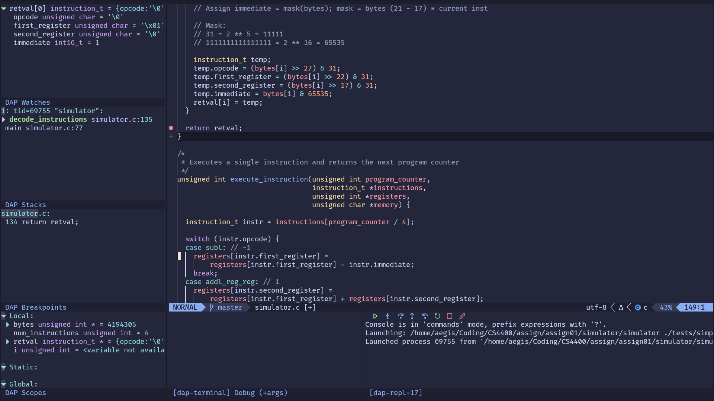
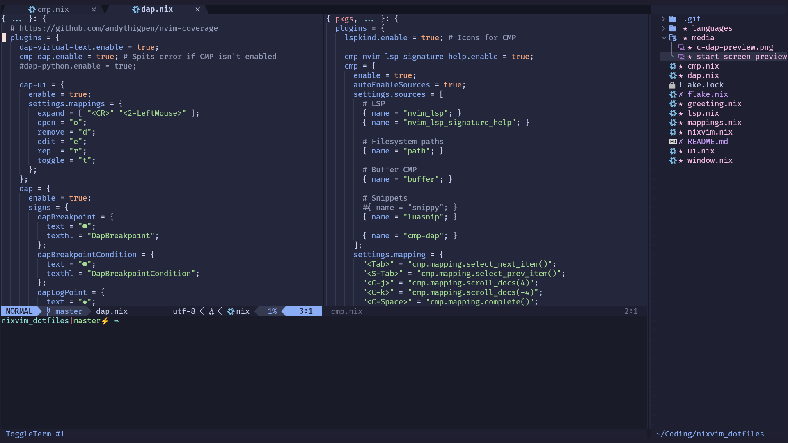
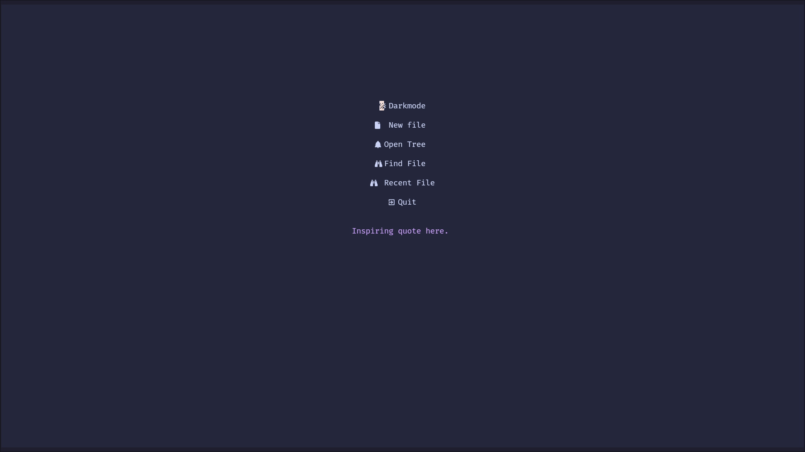

# Nixvim dotfiles

These are my nixvim dotfiles, I daily this everyday. I am still learning and if you find anything
of interest, please feel free to copy and paste.

## Screenshots







## Ruby on Rails

Ruby support uses Ruby LSP and prefers the version installed by Bundler in the
current project. Add the LSP and its Rails extension to each Rails application:

```sh
bundle add ruby-lsp ruby-lsp-rails --group development
```

## Debugging an ARM board with OpenOCD

The `Debug ARM C` DAP profile connects Nixpkgs GDB (which includes GDB's DAP
interpreter and ARM support) to OpenOCD's GDB server at `localhost:3333`.

Start OpenOCD in a terminal with the interface and target configuration for
your probe and board, for example:

```sh
openocd -f interface/<probe>.cfg -f target/<mcu>.cfg
```

Build the firmware with debug information, open a C source file in Nixvim, set
a breakpoint with `<leader>db`, then use `<leader>dc`. Select `Debug ARM C`
and enter the path to the unstripped ELF file when prompted. The first time you
flash a program, open the DAP REPL (`<leader>de`) and run:

```gdb
monitor reset halt
load
```

Then use `<leader>dc` to continue through DAP; do not issue `continue` from
the REPL. Do not reset a second time after `load`: GDB DAP can lose its current
frame when OpenOCD reports that reset event. `monitor reset halt` must be used
before `load` so OpenOCD can write the target's flash safely.
